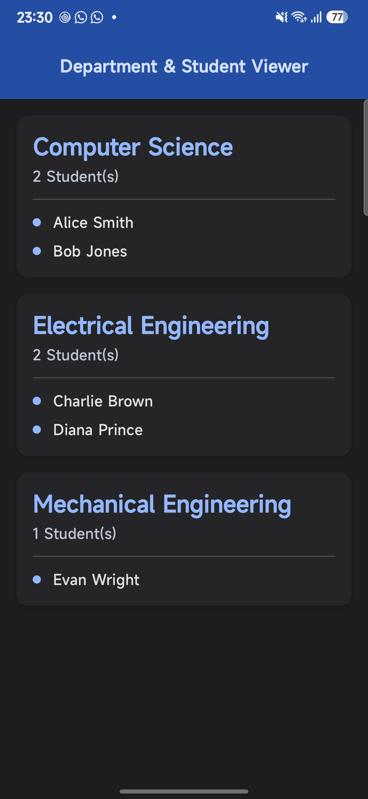
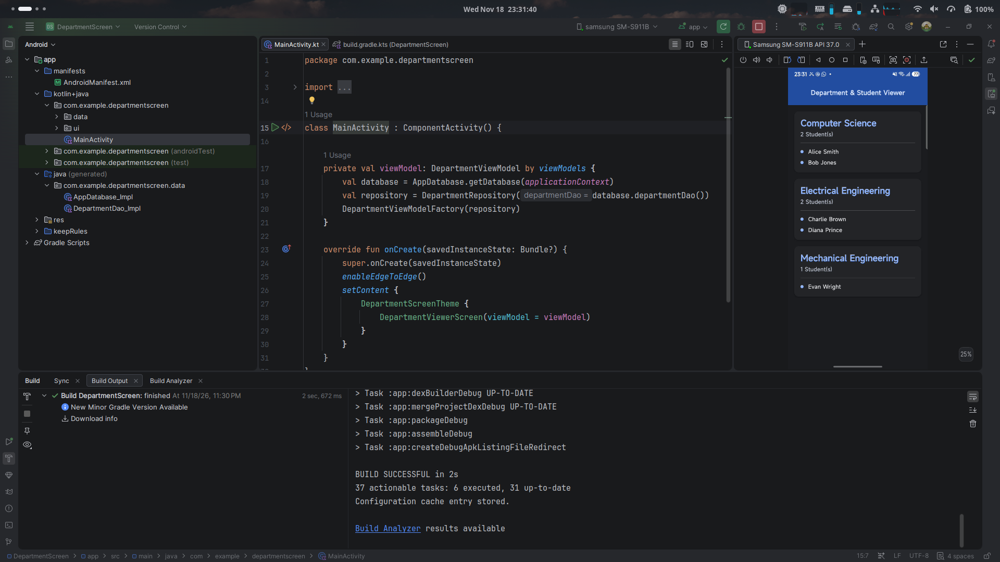

# Department & Student Viewer

A simple Android application built using **Kotlin, Jetpack Compose, Room Database, and MVVM architecture**.

## Screenshot

## Features

- Displays departments and their associated students.
- Room Database for local data persistence.
- One-to-Many relationship between Department and Student.
- `@Relation` and `@Transaction` for related database queries.
- Repository Pattern and MVVM architecture.
- Kotlin Flow and StateFlow for reactive data handling.
- Jetpack Compose UI with Material 3 components.

## Tech Stack

- Kotlin
- Android Studio
- Jetpack Compose
- Room Database
- Kotlin Coroutines and Flow
- StateFlow
- MVVM Architecture

## Project Structure

- `Department.kt` — Department entity.
- `Student.kt` — Student entity.
- `DepartmentWithStudents.kt` — Relationship mapping.
- `DepartmentDao.kt` — Database queries.
- `AppDatabase.kt` — Room database configuration.
- `DepartmentRepository.kt` — Data access layer.
- `DepartmentViewModel.kt` — UI state management.
- `DepartmentScreen.kt` — Compose UI.

## Purpose

Built as part of the CSE226 Android App Development coursework.
